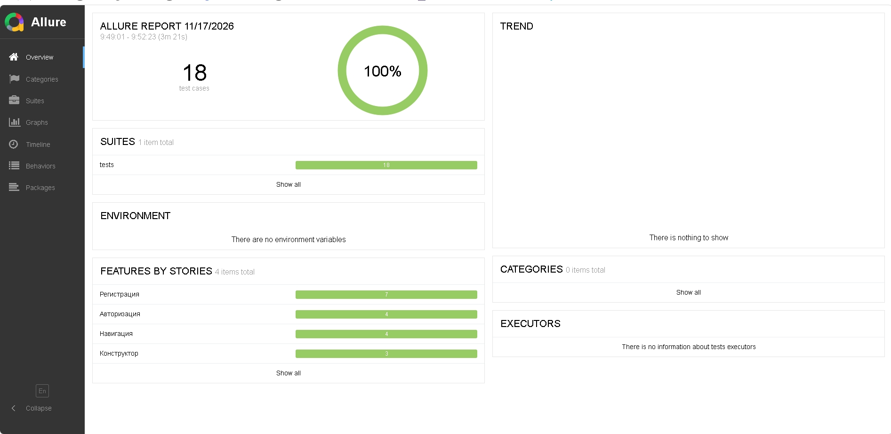

# Stellar Burgers

## Что тестирует проект

Тесты проверяют функционал сайта [Stellar Burgers](https://stellarburgers.education-services.ru):
- Регистрация пользователя
- Авторизация через разные точки входа
- Восстановление пароля
- Навигация по сайту
- Конструктор бургеров

## Технологии

- Python 3.11+
- Selenium (UI-тесты)
- Pytest
- Allure (отчетность)
- Requests (для создания пользователей через API)
- Pydantic (валидация моделей)
- Docker

## Установка и запуск

```bash
# Клонировать репозиторий
git clone <repository-url>
cd stellar_burgers_ruslan

# Создать виртуальное окружение
python -m venv venv
source venv/bin/activate  # на Windows: venv\Scripts\activate

# Установить зависимости
pip install -r requirements.txt
```

## Запуск тестов

```bash
# Запуск всех тестов
pytest

# Запуск на определенном окружении
pytest --env=dev
pytest --env=stage

# Запуск в определенном браузере
pytest --browser=chrome
pytest --browser=firefox

# Запуск в headless-режиме
pytest --headless

# Запуск с маркерами
pytest -m smoke
pytest -m regression
```

## Allure-отчёт

```bash
# Открыть отчёт в браузере
allure serve allure-results

# Сгенерировать отчёт в папку
allure generate allure-results -o allure-report --clean
```



## Запуск в Docker

Docker Desktop должен быть запущен.

```bash
docker compose up --build
```

Тесты запускаются в Chrome без окна. Отчёт сохраняется в папку `allure-results`.


